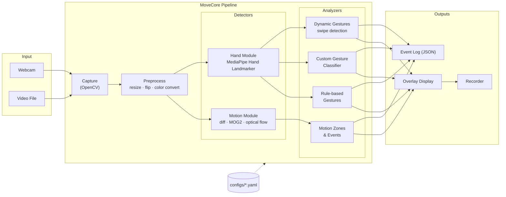
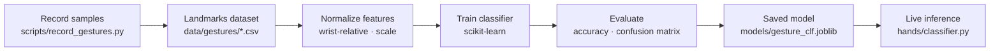

# CLAUDE.md — MoveCore Project Context (handoff)

> This file packs the full planning conversation for the **MoveCore** project so Claude Code can continue the work locally. Put it in the repo root as `CLAUDE.md` (Claude Code reads it automatically at the start of each session).
>
> Last updated: 2026-11-09

---

## 1. Who you're working with and how

- **Developer:** Ming (GitHub: `Mingpham`), IT student with a DevSecOps background.
- **Goal of the project:** *learning* how computer vision works by building a camera-based movement detection core. Explaining *why* matters as much as working code.
- **Working style to follow:**
  - Go milestone by milestone; finish, test and push one before starting the next.
  - After each changes and updates, do a overall check in term of: integrity, code smell, syntax errors, vulnerabilities, false codes,... to see if the changes actually fit the current code.
  - Explain new CV concepts briefly when introducing them (what the algorithm does, why the parameters matter).
  - Prefer small, readable modules over clever code. Add tests for every module.
  - Keep everything free and open source. Paid plans only after the project is finished and meets all requirements.
  - When using math in docs, use proper notation, e.g. $D(x,y,t) = |I(x,y,t) - I(x,y,t-1)|$.
- **Repo:** https://github.com/Mingpham/Motions_Detection_Core- (note the trailing hyphen in the name; renaming to `Motions_Detection_Core` was suggested but is optional).
- **Local folder:** `Motion_Detection` on the Mac.

---

## 2. Hardware and environment (⚠️ important)

- **Machine:** MacBook Air, **Apple M1, 8GB unified memory**, >100GB SSD.
- Every tool must run **natively on arm64**. Never run the project under Rosetta.
- Keep memory use low: 640×480 frames, one or two models at a time, no TensorFlow.

### Known environment issues (as of 2026-11-06)

1. **Homebrew is the Intel (x86_64) version** installed under `/usr/local`. Homebrew no longer ships bottles for Intel macOS, so `brew install` compiles from source (it tried to build LLVM and Rust for `uv` — hours of work, huge RAM use). That install was stopped.
   - Do **not** `brew install` heavy packages with this Homebrew.
   - Long-term fix (not urgent): install native Homebrew at `/opt/homebrew`.
2. **`uv` already works and is native:** `uv 0.13.7 (aarch64-apple-darwin)`.
3. **`gitleaks` 8.30.1 is installed** and works (`gitleaks git .` → no leaks).
4. **Anaconda `(base)` env is active** in the shell. It may be Intel. Always run `conda deactivate` before working on this project so uv uses its own native Python.
5. Verified 2026-11-06: arm64 throughout, Homebrew still Intel. `python3` on PATH is Anaconda's, so `pyproject.toml` sets `python-preference = "only-managed"`. To re-check:
   ```bash
   uname -m                                                       # expect: arm64
   which brew                                                     # /usr/local = Intel
   uv run python -c "import platform; print(platform.machine())"  # expect: arm64
   ```
   If `uname -m` prints `x86_64`, Terminal is running under Rosetta: Finder → Applications → Utilities → Terminal → Get Info → uncheck "Open using Rosetta".
6. **macOS camera permission:** the first camera run needs access granted to Terminal / VS Code in System Settings → Privacy & Security → Camera. A black window or empty frames usually means permission is missing.
7. Command Line Tools update is available (optional, via Software Update).

---

## 3. Project definition

**MoveCore — Movement Detection Core.** A camera-based engine that detects and understands movement in webcam or video input, built from classic computer vision up to ML-based hand gesture recognition. Inspired by a YouTube Shorts demo (hand tracking + gesture recognition + AR overlays + face emotion detection with Python, OpenCV and MediaPipe).

### Learning levels

1. **Classic motion detection (no ML):** frame differencing, background subtraction, optical flow.
2. **Landmark tracking (pretrained ML):** 21 hand keypoints per hand.
3. **Movement/gesture logic:** geometry rules → trained classifier → motion over time (swipes).
4. **Extras (later versions):** body pose, face/expression, AR overlays.

### Scope

| Version | Content |
|---|---|
| **v1 (current)** | **Module A — Classic motion** + **Module B — Hand tracking & gestures** |
| v2 | Body pose module |
| v3 | Face landmarks & expression module |

**Module A — Classic Motion (pure OpenCV)**
- Frame differencing
- Background subtraction (MOG2 / KNN)
- Optical flow: sparse (Lucas-Kanade) and dense (Farneback) → direction and speed
- Motion zones and events (motion started/stopped in zone X), bounding boxes

**Module B — Hand Gestures (MediaPipe)**
- Hand landmarks: 21 keypoints, up to 2 hands
- Rule-based gestures: finger counting, pinch, thumbs up
- MediaPipe built-in Gesture Recognizer (closed fist, open palm, pointing up, thumbs up/down, victory, "I love you") as a baseline
- Custom static gestures: record landmark samples → train scikit-learn classifier
- Dynamic gestures: swipe left/right/up/down from fingertip trajectories

---

## 4. Requirements

### Functional
- Accept webcam or video file input
- Detect and box moving regions; emit events when motion enters/leaves configured zones
- Estimate motion direction and speed (optical flow)
- Track up to 2 hands, 21 landmarks each
- Recognize rule-based, built-in, custom and dynamic gestures
- Display annotated output; log events as JSON (JSONL)

### Non-functional

| Requirement | Target |
|---|---|
| Throughput | ≥ 20 FPS at 640×480, both modules enabled, on M1 |
| Memory | < 1.5 GB RAM |
| Connectivity | Fully offline, no cloud calls |
| Extensibility | New module added without modifying the core pipeline |
| Reproducibility | Locked dependencies; tests run on recorded clips |

---

## 5. Tech stack (final for v1)

All free and open source.

| Purpose | Tool | Version (locked in uv.lock) | License |
|---|---|---|---|
| Language | Python 3.12 (`.python-version`), allowed `>=3.12,<3.14` | 3.12 | PSF |
| Env/package manager | uv | 0.13.7 locally | MIT/Apache |
| Vision core | opencv-python | 5.0.0.93 | Apache 2.0 |
| Hand models | mediapipe — **Tasks API only** | 1.2.2 | Apache 2.0 |
| Math | NumPy | 2.5.4 | BSD |
| Custom gesture classifier | scikit-learn | 1.9.1 | BSD |
| Config | PyYAML (`safe_load` only) | 6.0.3 | MIT |
| Lint/format | ruff (line length 100, rules E,F,W,I,B,UP,SIM,S) | — | MIT |
| Tests | pytest | — | MIT |
| Pre-commit | pre-commit (hooks: pre-commit-hooks v6.0.0, ruff-pre-commit v0.17.4, gitleaks v8.30.0) | — | MIT |
| Security | pip-audit, gitleaks, Dependabot | — | Apache/MIT |
| Diagrams | Mermaid (rendered by GitHub) | — | MIT |
| Paper | Markdown in `docs/paper/` (Typst later for PDF) | — | — |
| Later, optional | PyTorch with MPS backend (only if scikit-learn plateaus) | — | BSD |

The lockfile includes native macOS arm64 wheels: `mediapipe-1.2.2-py3-none-macosx_11_0_arm64.whl`, `opencv_python-5.0.0.93-cp37-abi3-macosx_13_0_arm64.whl`.

### Deliberately excluded
- **MediaPipe legacy `mp.solutions` API** — removed in MediaPipe 0.10.31; also had Apple Silicon bugs. Most online tutorials use it; translate them to the Tasks API instead of copying.
- **MediaPipe Model Maker** — depends on TensorFlow (heavy, version-fragile on 8GB M1).
- **TensorFlow** in general.
- **Ultralytics YOLO** for this project — not needed for v1, and it's **AGPL-3.0** (copyleft; distributing or serving it requires open-sourcing your code or buying a license). Keep in mind if object detection is added later; RF-DETR (Apache 2.0) is the permissive alternative.

---

## 6. Architecture

### Processing pipeline



### Custom gesture training flow



### Design principles
- **Plug-in modules:** every detector/analyzer subclasses `movecore.core.module.Module` (`setup()`, `process(ctx) -> ModuleResult`, `close()`).
- **Frame contract:** modules receive a `FrameContext` (`frame` BGR ndarray, `index`, `timestamp_ms`, `results` dict of earlier modules' outputs keyed by module `name`). Detectors run before the analyzers that read them.
- **Events:** modules return `Event(type, source, frame_index, timestamp_ms, payload)` in `ModuleResult.events`; the `Pipeline` publishes them on an `EventBus` (`subscribe(type, handler)`, `"*"` = all events). Event type naming: `motion.start`, `motion.stop`, `zone.enter`, `gesture.detected`, `gesture.swipe`, ...
- **Config-driven:** modules, thresholds and zones live in YAML; no hard-coding.
- **Offline first.**

---

## 7. Repository structure (Architecture Layout v1.0)

```
Motions_Detection_Core-/
├── CLAUDE.md                          # This file
├── README.md                          # Overview, CV fundamentals, diagrams (pushed ✅)
├── pyproject.toml                     # Deps & tool config (uv, ruff, pytest); entry point `movecore`
├── uv.lock                            # Locked versions
├── .python-version                    # 3.12
├── .pre-commit-config.yaml
├── .gitignore                         # ignores models/*, data/**, logs/, videos, .env, .venv ...
├── LICENSE                            # MIT, Copyright (c) 2026 Mingpham
├── docs/
│   ├── README.md
│   ├── fundamentals/                  # Learning notes per CV topic (add per milestone)
│   ├── architecture/                  # Diagrams
│   ├── decisions/                     # ADRs
│   │   ├── 0001-mediapipe-tasks-api.md
│   │   └── 0002-sklearn-for-custom-gestures.md
│   └── paper/                         # Project paper (outline not written yet)
├── configs/
│   ├── default.yaml                   # motion + hands enabled; optical_flow off until M3
│   ├── motion_only.yaml
│   └── hands_only.yaml
├── models/                            # MediaPipe .task files & trained classifiers (git-ignored)
├── data/{gestures,clips}/             # Datasets & test videos (git-ignored)
├── scripts/
│   ├── download_models.py             # ✅ exists
│   ├── record_gestures.py             # M5
│   ├── train_gesture_classifier.py    # M5
│   └── benchmark.py                   # M6
├── src/movecore/
│   ├── __init__.py                    # __version__ = "0.1.0"
│   ├── app.py                         # ✅ run loop: source → preprocess → pipeline → display
│   ├── cli.py                         # ✅ --config, --source, --loop, --headless, --max-frames, --version
│   ├── core/                          # ✅ module.py, events.py, config.py, pipeline.py
│   ├── capture/                       # ✅ source.py, camera.py (by index or name), video_file.py, selection.py
│   ├── preprocess/                    # ✅ transforms.py: crop-and-resize, mirror (color/blur added when needed)
│   ├── motion/                        # M2–M3: frame_diff, background_sub, optical_flow, morphology, zones
│   ├── hands/                         # M4–M6: landmarker, features, gesture_rules, gesture_recognizer, classifier, dynamic
│   └── output/                        # ✅ overlay.py (FPS, labels), display.py · later: event_logger, recorder
├── tests/
│   ├── conftest.py                    # make_video fixture: tiny MJPG clips generated per test
│   ├── unit/                          # ✅ config, pipeline, cli, dependencies, camera, video_file, selection, preprocess, overlay, display, app
│   ├── integration/                   # ✅ test_run_video.py: whole app headless on a generated clip (91 tests total)
│   └── fixtures/                      # tiny test images/clips
└── .github/
    ├── workflows/ci.yml               # ubuntu: apt libgl1/libglib2.0-0, setup-uv, uv sync --locked, ruff check, ruff format --check, pytest
    ├── workflows/security.yml         # pip-audit on exported lock (no dev, strict) + gitleaks (full history); weekly Mon 02:00 UTC
    └── dependabot.yml                 # uv + github-actions, weekly
```

### Current config shape (`configs/default.yaml`)

```yaml
input: {width: 640, height: 480, camera: FaceTime HD, flip: true}
modules:
  motion: {enabled: true, method: mog2, min_area: 500, zones: {}}
  optical_flow: {enabled: false, mode: sparse}
  hands:
    enabled: true
    max_hands: 2
    min_detection_confidence: 0.5
    gestures: {rules: true, builtin_recognizer: true, custom_classifier: false, dynamic: false}
output: {overlay: true, show_fps: true, event_log: logs/events.jsonl, record: false}
```

`load_config()` validates: file exists, root is a mapping, `input.width/height` positive ints, `modules` maps names → option dicts, `output` is a mapping. `AppConfig.enabled_modules()` returns names with `enabled: true`.

### Model download URLs (`scripts/download_models.py`)
- `https://storage.googleapis.com/mediapipe-models/hand_landmarker/hand_landmarker/float16/latest/hand_landmarker.task`
- `https://storage.googleapis.com/mediapipe-models/gesture_recognizer/gesture_recognizer/float16/latest/gesture_recognizer.task`

Verified on the Mac 2026-11-06: both download and run through the Tasks API in VIDEO mode. These `latest` URLs are unpinned, so the script prints each file's SHA-256.

---

## 8. Roadmap and progress

| Milestone | Deliverable | Status |
|---|---|---|
| Planning | Tool selection, stack, scope, README | ✅ Done |
| **M0** | Repo setup, environment, CI & security checks | ✅ Done — pushed as `0eb3670`, CI + Security green. Check Dependabot alerts are enabled (Settings → Code security) |
| **M1** | Capture pipeline (webcam + video) with FPS counter, overlay, quit key | 🟡 Code, tests and docs done (91 tests). **Pending:** live camera check by Ming, commit + push, CI green |
| M2 | Frame differencing → background subtraction → morphology/contours → zones & events | ⏳ |
| M3 | Optical flow (Lucas-Kanade sparse, Farneback dense) & motion direction/speed | ⏳ |
| M4 | Hand landmarks, rule-based gestures, built-in Gesture Recognizer | ⏳ |
| M5 | Gesture recorder + custom scikit-learn classifier (+ evaluation) | ⏳ |
| M6 | Dynamic swipe gestures, benchmarks (FPS/RAM), documentation, paper | ⏳ |
| v2 / v3 | Body pose / face & expression | 🔮 |

### M1 summary
- **Sources:** `open_source()` takes a camera index (`0`), a camera name (`FaceTime HD`) or a video path. With no `--source`, it uses `input.camera` from the config. Cameras retry up to 50 empty reads while starting. Video timestamps follow the file's own frame rate.
- **Camera by name:** OpenCV numbers macOS cameras by sorted unique ID, and Ming's iPhone (Continuity Camera, kept on deliberately) sorts first. Names are resolved via `system_profiler` (ADR 0003).
- **Preprocess:** center-crop to the target aspect ratio, then resize (`INTER_AREA` when shrinking), then optionally mirror.
- **Display:** `q`, `Esc` or the red close button quits. On macOS, `getWindowProperty` raises once the window is gone, which is handled as closed.
- **Modules:** `app.MODULES` maps config names to classes. Enabled names that aren't registered yet are reported and skipped. M2 registers `motion` there.
- **Baseline:** capture plus preprocess runs at ~345 FPS on a 1280×720 video (headless).
- **Run:** `uv run movecore`, `uv run movecore --source clip.mp4 --loop`, or `uv run movecore --headless --max-frames 300` for a quick benchmark.

### M1 remaining
```bash
uv run movecore          # window shows the Mac camera; q or Esc quits
git add . && git commit -m "feat: M1 capture pipeline with camera, video, preprocessing and display"
git push
```

---

## 9. Computer vision fundamentals (reference)

### Images and video
- A color frame is an array `H × W × 3` of values 0–255. **OpenCV uses BGR**, MediaPipe expects **RGB** → convert with `cv2.cvtColor(frame, cv2.COLOR_BGR2RGB)`.
- Video = sequence of frames: $I(x, y, t) \in [0, 255]$.
- Grayscale reduces computation 3× and keeps structure for motion; Gaussian blur suppresses sensor noise before comparing frames.

### Frame differencing
$$D(x, y, t) = \left| I(x, y, t) - I(x, y, t-1) \right|$$
Pixel is moving if $D(x,y,t) > T$ → binary motion mask. Fast, but sensitive to noise, lighting changes and camera shake.

### Background subtraction
Learn a background model instead of comparing to the last frame. **MOG2** models each pixel as a mixture of Gaussians that adapts over time; non-fitting pixels = foreground. Can mark shadows (value 127 in the mask — threshold them out). KNN is an alternative.

### Morphology and contours
- Erosion removes speckles; dilation fills holes; opening = erode→dilate; closing = dilate→erode.
- `cv2.findContours` on the cleaned mask; contours with area ≥ `min_area` become bounding boxes.

### Optical flow
Brightness constancy: $I(x, y, t) = I(x + \Delta x,\ y + \Delta y,\ t + \Delta t)$.
First-order Taylor expansion → **optical flow constraint**: $I_x u + I_y v + I_t = 0$ (one equation, two unknowns: the aperture problem).
- **Lucas-Kanade (sparse):** assumes constant flow in a small window, solves least squares around good corners (`cv2.goodFeaturesToTrack` + `cv2.calcOpticalFlowPyrLK`, pyramids for larger motion).
- **Farneback (dense):** flow for every pixel (`cv2.calcOpticalFlowFarneback`); visualize with HSV (hue = direction, value = magnitude). Heavier — use smaller resolution.

### Combined design (motion as a trigger)
Cheap motion detection on every frame → run heavier models only when/where motion appears → tracking for path, speed, direction, zone crossing. Saves compute on edge devices.

### Hand landmarks (MediaPipe Hand Landmarker)
- Two-stage: palm detector → landmark model; then tracking across frames (cheap).
- **21 3D landmarks**: 0 wrist; thumb 1–4; index 5–8; middle 9–12; ring 13–16; pinky 17–20 (tips: 4, 8, 12, 16, 20; MCP knuckles: 5, 9, 13, 17).
- x, y normalized to [0, 1] of image size; z = relative depth with wrist as origin.
- Use `RunningMode.VIDEO` (with increasing timestamps in ms) for files/webcam synchronous processing, or `LIVE_STREAM` with a callback.

### Gesture recognition approaches
| Approach | How | Strength |
|---|---|---|
| Rule-based | Geometry: fingertip vs PIP/MCP joint position, thumb–index distance | Transparent, no data |
| Built-in recognizer | MediaPipe pretrained, 7 gestures | Baseline |
| Custom classifier | Normalize landmarks (subtract wrist, divide by hand size) → 63 features → scikit-learn | Your own gestures |
| Dynamic | Fingertip positions over a sliding window → velocity & direction | Swipes / motion |

Normalization makes features independent of hand position (wrist-relative) and distance from camera (scale). Mirror handling: with `flip: true`, MediaPipe handedness labels may appear swapped — handle consistently.

### Beyond v1 (for context)
Pose estimation (33 body keypoints: fall detection, exercise), action recognition (running, loitering), object detection (YOLO/RF-DETR) — the same pipeline pattern applies.

---

## 10. Engineering conventions

- **Package manager:** uv only (`uv add`, `uv sync`, `uv run`). Don't use pip directly; don't commit `.venv`.
- **Commits:** Conventional Commits (`feat:`, `fix:`, `docs:`, `test:`, `chore:`, `refactor:`). One milestone may be several commits.
- **Before pushing:** `uv run ruff check . && uv run ruff format --check . && uv run pytest`.
- **Tests:** every module gets unit tests with synthetic NumPy frames (e.g. a white square moving across a black frame for motion tests). No webcam in CI. Integration tests use tiny clips generated in fixtures (keep files < 1MB; pre-commit blocks large files).
- **Security (DevSecOps):** YAML via `safe_load` only; never commit secrets/tokens/`.env`; models and videos never in git; validate file paths from CLI; pin and lock dependencies; let Dependabot + pip-audit + gitleaks run.
- **Performance:** measure FPS whenever adding a module; target ≥ 20 FPS at 640×480 with everything on.
- **Docs:** add an ADR in `docs/decisions/` for each significant choice; add a fundamentals note per milestone; update README roadmap status.

---

## 11. Warnings and gotchas (checklist)

- ⚠️ Intel Homebrew on an M1 → compiles from source; avoid heavy `brew install`.
- ⚠️ Deactivate conda before using uv.
- ⚠️ Use MediaPipe **Tasks API** (`mediapipe.tasks.python.vision`), never `mp.solutions`.
- ⚠️ BGR (OpenCV) vs RGB (MediaPipe).
- ⚠️ MediaPipe VIDEO mode needs strictly increasing timestamps.
- ⚠️ macOS camera permission for Terminal/VS Code. It belongs to the app that launches the program, so Claude Code's shell can't open the camera; Ming runs live camera checks.
- ⚠️ Don't select cameras by bare index on this Mac: the iPhone (Continuity Camera) takes index 0 when nearby. Use `input.camera: FaceTime HD`.
- ⚠️ `cv2.imshow` must run on the main thread on macOS; call `cv2.waitKey(1)` each frame.
- ⚠️ 8GB RAM: keep 640×480, avoid loading unused models, release `VideoCapture` and close landmarkers.
- ⚠️ The upstream `gitleaks-system` pre-commit hook lacks `pass_filenames: false`; keep the override in `.pre-commit-config.yaml` or every commit fails.
- ⚠️ CI runs on Ubuntu (needs `libgl1` for OpenCV); macOS runners cost extra minutes on private repos.
- ⚠️ Licenses: v1 stack is all permissive (Apache/MIT/BSD). Ultralytics YOLO is AGPL-3.0; SAM 3 has a custom license; Roboflow free tier makes datasets public.

---

## 12. Related earlier discussion (separate idea, not active)

Before MoveCore, Ming explored a **custom object detection engine** (detect user-configured objects in images/videos via a YAML config with "prompt" mode or "trained" mode). Recommended stack then: Ultralytics YOLO (YOLO26/YOLO11, AGPL) or RF-DETR (Apache 2.0, non-XL sizes) + supervision (MIT) + OpenCV, YOLOE/YOLO-World or Grounding DINO/OWLv2 for open-vocabulary prompts and auto-labeling, CVAT or Label Studio for labeling, ONNX Runtime/OpenVINO for inference, FastAPI + Docker for serving. This may come back as a future module; MoveCore's plug-in design should make that possible.
