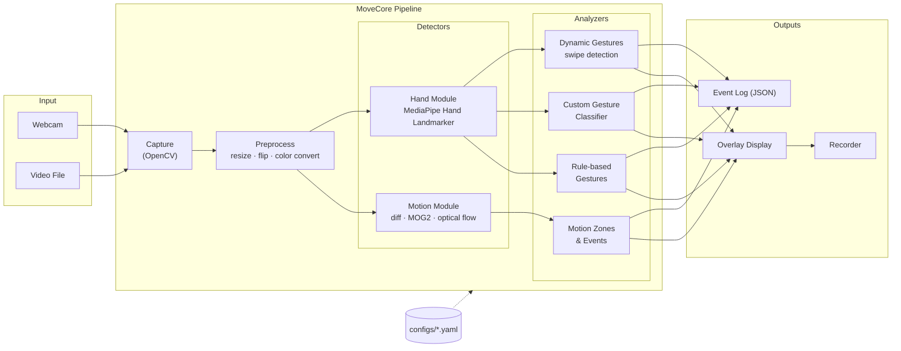
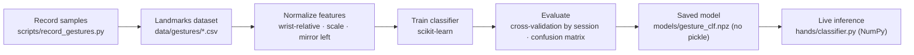

# MoveCore — Movement Detection Core

A camera-based movement detection engine built to learn computer vision from the ground up: from classic pixel-level motion detection to real-time hand tracking and gesture recognition. Runs fully offline on a MacBook Air M1 (8GB) using only free, open-source tools.

---

## 📑 Table of Contents

1. [Project Goals](#-project-goals)
2. [System Architecture](#-system-architecture)
3. [Project Structure (Architecture Layout v1.0)](#-project-structure-architecture-layout-v10)
4. [Getting Started](#-getting-started)
5. [License](#-license)

---

## 🎯 Project Goals

- **Learn** how computer vision works: images as data, motion over time, and how ML models turn pixels into structured information.
- **Build** a modular movement detection core where each detector is a plug-in module, toggled through configuration.
- **Run** in real time on modest hardware (Apple M1, 8GB RAM), fully offline.
- **Practice** clean engineering: tests, CI, dependency and secret scanning, and documented design decisions.

### v1 Scope

| Module | Features |
|---|---|
| **A — Classic Motion** | Frame differencing, background subtraction (MOG2/KNN), optical flow (Lucas-Kanade & Farneback), motion zones and events |
| **B — Hand Gestures** | 21-point hand landmarks, rule-based gestures (finger count, pinch, thumbs up), MediaPipe built-in Gesture Recognizer, custom static gestures (scikit-learn), dynamic swipe gestures |

---

## 🏗️ System Architecture

### Processing Pipeline

The plan below; [docs/architecture](docs/architecture/README.md) shows the system as built.



### Custom Gesture Training Flow



### Design Principles

- **Plug-in modules:** every detector and analyzer implements a common interface, so new modules (pose, face) can be added without touching the core.
- **Config-driven:** modules, thresholds and zones are set in YAML, not hard-coded.
- **Frame-by-frame contract:** each module receives a frame context and returns structured results, making modules easy to test with recorded clips.
- **Offline first:** all models run locally; no cloud calls.

---

## 🗂️ Project Structure (Architecture Layout v1.0)

```
movement-detection-core/
│
├── README.md                          # Project overview & CV fundamentals (this file)
├── pyproject.toml                     # Dependencies & tool config (uv, ruff, pytest)
├── uv.lock                            # Locked dependency versions
├── .pre-commit-config.yaml            # Pre-commit hooks (ruff, gitleaks)
├── LICENSE
│
├── docs/                              # DOCUMENTATION
│   ├── fundamentals/                  # Learning notes per CV topic
│   ├── architecture/                  # System diagrams (Mermaid) & data flow
│   ├── decisions/                     # Architecture Decision Records (ADRs)
│   └── paper/                         # Project paper (report)
│
├── configs/                           # RUNTIME CONFIGURATION
│   ├── default.yaml                   # Default: all v1 modules enabled
│   ├── motion_only.yaml               # Classic motion module only
│   └── hands_only.yaml                # Hand gesture module only
│
├── models/                            # Downloaded MediaPipe .task files & trained classifiers (git-ignored)
│
├── data/                              # DATASETS (git-ignored)
│   ├── gestures/                      # Recorded landmark samples (CSV)
│   └── clips/                         # Recorded test videos
│
├── scripts/                           # DEVELOPER TOOLS
│   ├── download_models.py             # Fetch MediaPipe models
│   ├── record_gestures.py             # Capture labeled gesture samples
│   ├── train_gesture_classifier.py    # Train & evaluate custom classifier
│   └── benchmark.py                   # FPS & memory benchmarks
│
├── src/movecore/                      # CORE PACKAGE
│   ├── core/                          # Pipeline orchestration
│   │   ├── pipeline.py                # Main frame loop
│   │   ├── config.py                  # YAML config loading & validation
│   │   ├── module.py                  # Base interface for detectors/analyzers
│   │   ├── events.py                  # Event types & event bus
│   │   ├── options.py                 # Shared checks for module options
│   │   └── debounce.py                # Debouncer & StableLabel: flicker → clean events
│   │
│   ├── capture/                       # INPUT SOURCES
│   │   ├── camera.py                  # Webcam capture
│   │   └── video_file.py              # Video file playback
│   │
│   ├── preprocess/                    # Resize, flip, color conversion, blur
│   │
│   ├── motion/                        # MODULE A — CLASSIC MOTION
│   │   ├── frame_diff.py              # Frame differencing
│   │   ├── background_sub.py          # MOG2 / KNN background subtraction
│   │   ├── optical_flow.py            # Lucas-Kanade & Farneback
│   │   ├── morphology.py              # Mask cleaning & contour extraction
│   │   └── zones.py                   # Motion zones & enter/leave events
│   │
│   ├── hands/                         # MODULE B — HAND GESTURES
│   │   ├── module.py                  # Hands module: landmarks → gestures → events
│   │   ├── landmarker.py              # MediaPipe wrapper (Hand Landmarker or Gesture Recognizer)
│   │   ├── landmarks.py               # The 21 points, bones, and the Hand type
│   │   ├── gesture_rules.py           # Rule-based gestures (finger count, pinch, thumb up/down)
│   │   ├── settings.py                # Option checks for modules.hands
│   │   ├── features.py                # 63 numbers per hand: wrist-relative, scaled, mirrored
│   │   ├── dataset.py                 # Recorded samples: CSV writing, loading, validation
│   │   ├── recorder.py                # What to keep while recording a gesture
│   │   ├── training.py                # scikit-learn training & cross-validation (training only)
│   │   ├── classifier.py              # Run the trained model with NumPy; .npz, no pickle
│   │   └── dynamic.py                 # Fingertip swipes (any finger, grouped) and the palm's path
│   │
│   ├── output/                        # OUTPUTS
│   │   ├── overlay.py                 # Draw boxes, landmarks, labels, FPS
│   │   ├── event_logger.py            # JSON event logging
│   │   └── recorder.py                # Save annotated video
│   │
│   └── cli.py                         # Command-line entry point
│
├── tests/                             # TESTS
│   ├── unit/                          # Per-module tests
│   ├── integration/                   # Full pipeline on recorded clips
│   └── fixtures/                      # Small test images & clips
│
└── .github/                           # CI/CD & SECURITY
    ├── workflows/
    │   ├── ci.yml                     # Lint (ruff) + tests (pytest)
    │   └── security.yml               # pip-audit + gitleaks secret scan
    └── dependabot.yml                 # Automated dependency updates
```

---

## 🚀 Getting Started

> Motion detection (M2), optical flow (M3) and hand tracking (M4) work: moving regions get boxes, arrows show direction and speed, hands get a 21-point skeleton with finger count and gesture labels, and events print in the terminal and go to `logs/events.jsonl`.

### Prerequisites

- macOS on Apple Silicon (native arm64 — do **not** run under Rosetta)
- A webcam (built-in is fine)

### Setup

```bash
# 1. Install uv (native installer; works on Apple Silicon without Homebrew)
curl -LsSf https://astral.sh/uv/install.sh | sh

# 2. Clone the repository
git clone https://github.com/Mingpham/Motions_Detection_Core-.git
cd Motions_Detection_Core-

# 3. Create the environment and install dependencies
uv sync

# 4. Download MediaPipe models
uv run python scripts/download_models.py

# 5. Run with the default config (the camera named in input.camera); q or Esc quits
uv run movecore

# See what the motion detector sees: the mask appears beside the image
uv run movecore --show-mask

# Hands only (faster), or motion only
uv run movecore --config configs/hands_only.yaml
uv run movecore --config configs/motion_only.yaml

# Or run on a video file
uv run movecore --source data/clips/sample.mp4

# Check the performance targets (>= 20 FPS, < 1.5 GB) on a clip with hands in it
uv run python scripts/benchmark.py --source data/clips/hands.mp4

# Teach it your own gestures (see docs/fundamentals/05-custom-gestures.md)
uv run python scripts/record_gestures.py rock      # SPACE to record, q to quit; repeat per gesture
uv run python scripts/train_gesture_classifier.py  # prints accuracy, saves models/gesture_clf.npz
# then set modules.hands.gestures.custom_classifier: true
```

### macOS camera permission

On first run, macOS asks for camera access. If the window stays black, open **System Settings → Privacy & Security → Camera** and enable access for your terminal app or VS Code, then restart it.

### Development

```bash
uv run ruff check .          # Lint
uv run pytest                # Run tests
uv run pre-commit install    # Enable pre-commit hooks
```

---

## 📄 License

This project is released under the MIT License. Third-party libraries keep their own licenses (see [Tech Stack](#-tech-stack)).
