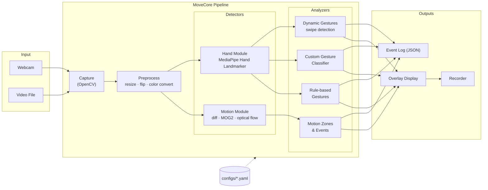
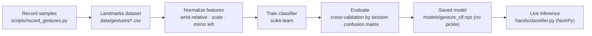

# MoveCore — Movement Detection Core

A camera-based movement detection engine built to learn computer vision from the ground up: from classic pixel-level motion detection to real-time hand tracking and gesture recognition. Runs fully offline on a MacBook Air M1 (8GB) using only free, open-source tools.

> **Status:** 🚧 In development — v1 scope: **Classic Motion Detection** + **Hand Tracking & Gestures**. Body pose and face/emotion modules are planned for later versions.

---

## 📑 Table of Contents

1. [Project Goals](#-project-goals)
2. [Computer Vision Fundamentals](#-computer-vision-fundamentals)
3. [System Architecture](#-system-architecture)
4. [Project Structure (Architecture Layout v1.0)](#-project-structure-architecture-layout-v10)
5. [Tech Stack](#-tech-stack)
6. [Requirements](#-requirements)
7. [Roadmap](#-roadmap)
8. [Getting Started](#-getting-started)
9. [License](#-license)

---

## 🎯 Project Goals

- **Learn** how computer vision works: images as data, motion over time, and how ML models turn pixels into structured information.
- **Build** a modular movement detection core where each detector is a plug-in module, toggled through configuration.
- **Run** in real time on modest hardware (Apple M1, 8GB RAM), fully offline.
- **Practice** clean engineering: tests, CI, dependency and secret scanning, and documented design decisions.

### v1 Scope

| Module | Features |
|---|---|
| **A — Classic Motion** | Frame differencing, background subtraction (MOG2/KNN), optical flow (Lucas-Kanade & Farneback), motion zones and events |
| **B — Hand Gestures** | 21-point hand landmarks, rule-based gestures (finger count, pinch, thumbs up), MediaPipe built-in Gesture Recognizer, custom static gestures (scikit-learn), dynamic swipe gestures |

---

## 📚 Computer Vision Fundamentals

### 1. An image is a matrix of numbers

A color frame is a 3D array of shape `H × W × 3`. Each pixel holds three intensity values from 0 to 255. OpenCV stores channels in **BGR** order (not RGB). A video is simply a sequence of these frames over time:

$$I(x, y, t) \in [0, 255]$$

Many algorithms first convert to **grayscale** (one channel), which reduces computation by 3× and keeps the structure needed for motion analysis. A **Gaussian blur** is usually applied to suppress camera noise before comparing frames.

### 2. Frame differencing — "did anything change?"

The simplest motion detector compares the current frame with the previous one:

$$D(x, y, t) = \left| I(x, y, t) - I(x, y, t-1) \right|$$

A pixel is marked as moving when $D(x, y, t) > T$ for a chosen threshold $T$. The result is a binary **motion mask**. It is fast but sensitive to noise, lighting changes, and camera shake.

### 3. Background subtraction — "what is foreground?"

Instead of comparing against the last frame, the system learns a **background model**. MOG2 models each pixel as a mixture of Gaussian distributions that adapts over time. Pixels that don't fit the background model are classified as foreground (moving objects). MOG2 can also detect and label shadows.

### 4. Cleaning the mask — morphology and contours

Raw masks contain speckles and holes. **Morphological operations** fix this:

- **Erosion** removes small noise points.
- **Dilation** fills gaps inside moving regions.
- **Opening** (erode → dilate) and **closing** (dilate → erode) combine both.

Then **contours** are extracted from the mask. Each contour large enough to matter becomes a **bounding box** — a detected moving region.

### 5. Optical flow — "where and how fast is it moving?"

Optical flow estimates the motion vector $(u, v)$ of pixels between frames. It relies on the **brightness constancy assumption**: a point keeps its brightness as it moves.

$$I(x, y, t) = I(x + \Delta x,\ y + \Delta y,\ t + \Delta t)$$

A first-order Taylor expansion gives the **optical flow constraint equation**:

$$I_x u + I_y v + I_t = 0$$

where $I_x, I_y$ are spatial gradients and $I_t$ is the temporal gradient.

- **Lucas-Kanade (sparse):** solves the equation over a small window around selected corner points. Fast; good for tracking specific features.
- **Farneback (dense):** estimates a flow vector for every pixel. Heavier; produces a full motion field, often visualized with color (hue = direction, brightness = speed).

### 6. Hand landmarks — from pixels to keypoints

MediaPipe's Hand Landmarker uses a **two-stage neural network pipeline**:

1. A **palm detector** finds hands in the full frame.
2. A **landmark model** predicts **21 3D keypoints** (wrist, knuckles, finger joints, fingertips) inside each hand region.

Coordinates are normalized to `[0, 1]` relative to the image size; `z` is the relative depth with the wrist as origin. Once hands are found, MediaPipe tracks them across frames instead of re-detecting every frame, which keeps it fast on CPU.

```
        8   12  16  20        ← fingertips
        |   |   |   |
        7   11  15  19
        |   |   |   |
   4    6   10  14  18
   |    |   |   |   |
   3    5---9---13--17        ← knuckles (MCP)
    \   |           /
     2  |          /
      \ |         /
       1|        /
        0--------             ← wrist
```

### 7. Gesture recognition — from keypoints to meaning

| Approach | How it works | Strength |
|---|---|---|
| **Rule-based** | Geometry on landmarks: is the fingertip farther from the wrist than its middle joint? Distance between thumb and index tips? | Transparent, no training data |
| **Built-in recognizer** | MediaPipe's pretrained model for 7 common gestures | Strong baseline |
| **Custom classifier** | Landmarks are normalized (relative to wrist, scaled by hand size) into a 63-value feature vector, then classified with scikit-learn | Learns your own gestures |
| **Dynamic gestures** | Track fingertip positions over a sliding time window; analyze velocity and direction | Detects movement like swipes |

**Normalization matters:** subtracting the wrist position makes features independent of where the hand is in the frame, and dividing by hand size makes them independent of distance from the camera.

---

## 🏗️ System Architecture

### Processing Pipeline



### Custom Gesture Training Flow



### Design Principles

- **Plug-in modules:** every detector and analyzer implements a common interface, so new modules (pose, face) can be added without touching the core.
- **Config-driven:** modules, thresholds and zones are set in YAML, not hard-coded.
- **Frame-by-frame contract:** each module receives a frame context and returns structured results, making modules easy to test with recorded clips.
- **Offline first:** all models run locally; no cloud calls.

---

## 🗂️ Project Structure (Architecture Layout v1.0)

```
movement-detection-core/
│
├── README.md                          # Project overview & CV fundamentals (this file)
├── pyproject.toml                     # Dependencies & tool config (uv, ruff, pytest)
├── uv.lock                            # Locked dependency versions
├── .pre-commit-config.yaml            # Pre-commit hooks (ruff, gitleaks)
├── LICENSE
│
├── docs/                              # DOCUMENTATION
│   ├── fundamentals/                  # Learning notes per CV topic
│   ├── architecture/                  # System diagrams (Mermaid) & data flow
│   ├── decisions/                     # Architecture Decision Records (ADRs)
│   └── paper/                         # Project paper (report)
│
├── configs/                           # RUNTIME CONFIGURATION
│   ├── default.yaml                   # Default: all v1 modules enabled
│   ├── motion_only.yaml               # Classic motion module only
│   └── hands_only.yaml                # Hand gesture module only
│
├── models/                            # Downloaded MediaPipe .task files & trained classifiers (git-ignored)
│
├── data/                              # DATASETS (git-ignored)
│   ├── gestures/                      # Recorded landmark samples (CSV)
│   └── clips/                         # Recorded test videos
│
├── scripts/                           # DEVELOPER TOOLS
│   ├── download_models.py             # Fetch MediaPipe models
│   ├── record_gestures.py             # Capture labeled gesture samples
│   ├── train_gesture_classifier.py    # Train & evaluate custom classifier
│   └── benchmark.py                   # FPS & memory benchmarks
│
├── src/movecore/                      # CORE PACKAGE
│   ├── core/                          # Pipeline orchestration
│   │   ├── pipeline.py                # Main frame loop
│   │   ├── config.py                  # YAML config loading & validation
│   │   ├── module.py                  # Base interface for detectors/analyzers
│   │   ├── events.py                  # Event types & event bus
│   │   ├── options.py                 # Shared checks for module options
│   │   └── debounce.py                # Debouncer & StableLabel: flicker → clean events
│   │
│   ├── capture/                       # INPUT SOURCES
│   │   ├── camera.py                  # Webcam capture
│   │   └── video_file.py              # Video file playback
│   │
│   ├── preprocess/                    # Resize, flip, color conversion, blur
│   │
│   ├── motion/                        # MODULE A — CLASSIC MOTION
│   │   ├── frame_diff.py              # Frame differencing
│   │   ├── background_sub.py          # MOG2 / KNN background subtraction
│   │   ├── optical_flow.py            # Lucas-Kanade & Farneback
│   │   ├── morphology.py              # Mask cleaning & contour extraction
│   │   └── zones.py                   # Motion zones & enter/leave events
│   │
│   ├── hands/                         # MODULE B — HAND GESTURES
│   │   ├── module.py                  # Hands module: landmarks → gestures → events
│   │   ├── landmarker.py              # MediaPipe wrapper (Hand Landmarker or Gesture Recognizer)
│   │   ├── landmarks.py               # The 21 points, bones, and the Hand type
│   │   ├── gesture_rules.py           # Rule-based gestures (finger count, pinch, thumb up/down)
│   │   ├── settings.py                # Option checks for modules.hands
│   │   ├── features.py                # 63 numbers per hand: wrist-relative, scaled, mirrored
│   │   ├── dataset.py                 # Recorded samples: CSV writing, loading, validation
│   │   ├── recorder.py                # What to keep while recording a gesture
│   │   ├── training.py                # scikit-learn training & cross-validation (training only)
│   │   ├── classifier.py              # Run the trained model with NumPy; .npz, no pickle
│   │   └── dynamic.py                 # (M6) Swipe / motion-over-time gestures
│   │
│   ├── output/                        # OUTPUTS
│   │   ├── overlay.py                 # Draw boxes, landmarks, labels, FPS
│   │   ├── event_logger.py            # JSON event logging
│   │   └── recorder.py                # Save annotated video
│   │
│   └── cli.py                         # Command-line entry point
│
├── tests/                             # TESTS
│   ├── unit/                          # Per-module tests
│   ├── integration/                   # Full pipeline on recorded clips
│   └── fixtures/                      # Small test images & clips
│
└── .github/                           # CI/CD & SECURITY
    ├── workflows/
    │   ├── ci.yml                     # Lint (ruff) + tests (pytest)
    │   └── security.yml               # pip-audit + gitleaks secret scan
    └── dependabot.yml                 # Automated dependency updates
```

---

## 🧰 Tech Stack

All tools are free and open source.

| Purpose | Tool | License |
|---|---|---|
| Language | Python 3.12 (managed with [uv](https://github.com/astral-sh/uv)) | PSF / MIT-Apache |
| Vision core | [OpenCV](https://opencv.org/) (`opencv-python`) | Apache 2.0 |
| Hand models | [MediaPipe](https://ai.google.dev/edge/mediapipe) — **Tasks API** | Apache 2.0 |
| Numerical | NumPy | BSD |
| Gesture classifier | scikit-learn | BSD |
| Configuration | PyYAML | MIT |
| Lint / format | ruff | MIT |
| Testing | pytest | MIT |
| Security | pip-audit, gitleaks, Dependabot | Apache 2.0 / MIT |
| Diagrams | Mermaid (rendered by GitHub) | MIT |

> ⚠️ **MediaPipe note:** this project uses the **Tasks API** (`mediapipe.tasks.vision`). The legacy `mp.solutions` API used by many older tutorials has been removed from recent MediaPipe releases.

---

## ✅ Requirements

### Functional

- Accept webcam or video file input
- Detect and box moving regions; emit events when motion enters or leaves configured zones
- Estimate motion direction and speed with optical flow
- Track up to 2 hands with 21 landmarks each
- Recognize rule-based, built-in, custom and dynamic (swipe) gestures
- Display annotated output and log events as JSON

### Non-functional

| Requirement | Target |
|---|---|
| Throughput | ≥ 20 FPS at 640×480, both modules enabled, on Apple M1 |
| Memory | < 1.5 GB RAM |
| Connectivity | Fully offline |
| Extensibility | New module added without modifying the core pipeline |
| Reproducibility | Locked dependencies; tests run on recorded clips |

---

## 🗺️ Roadmap

| Milestone | Deliverable | Status |
|---|---|---|
| **M0** | Repo setup, environment, CI & security checks | ✅ |
| **M1** | Capture pipeline (webcam + video) with FPS counter | ✅ |
| **M2** | Frame differencing → background subtraction → zones & events | ✅ |
| **M3** | Optical flow & motion direction | ✅ |
| **M4** | Hand landmarks, rule-based gestures, built-in recognizer | ✅ |
| **M5** | Gesture recorder + custom classifier | 🟡 |
| **M6** | Dynamic swipe gestures, benchmarks, documentation | ⏳ |
| **v2** | Body pose module | 🔮 |
| **v3** | Face landmarks & expression module | 🔮 |

---

## 🚀 Getting Started

> Motion detection (M2), optical flow (M3) and hand tracking (M4) work: moving regions get boxes, arrows show direction and speed, hands get a 21-point skeleton with finger count and gesture labels, and events print in the terminal and go to `logs/events.jsonl`.

### Prerequisites

- macOS on Apple Silicon (native arm64 — do **not** run under Rosetta)
- A webcam (built-in is fine)

### Setup

```bash
# 1. Install uv (native installer; works on Apple Silicon without Homebrew)
curl -LsSf https://astral.sh/uv/install.sh | sh

# 2. Clone the repository
git clone https://github.com/Mingpham/Motions_Detection_Core-.git
cd Motions_Detection_Core-

# 3. Create the environment and install dependencies
uv sync

# 4. Download MediaPipe models
uv run python scripts/download_models.py

# 5. Run with the default config (the camera named in input.camera); q or Esc quits
uv run movecore

# See what the motion detector sees: the mask appears beside the image
uv run movecore --show-mask

# Hands only (faster), or motion only
uv run movecore --config configs/hands_only.yaml
uv run movecore --config configs/motion_only.yaml

# Or run on a video file
uv run movecore --source data/clips/sample.mp4

# Teach it your own gestures (see docs/fundamentals/05-custom-gestures.md)
uv run python scripts/record_gestures.py rock      # SPACE to record, q to quit; repeat per gesture
uv run python scripts/train_gesture_classifier.py  # prints accuracy, saves models/gesture_clf.npz
# then set modules.hands.gestures.custom_classifier: true
```

### macOS camera permission

On first run, macOS asks for camera access. If the window stays black, open **System Settings → Privacy & Security → Camera** and enable access for your terminal app or VS Code, then restart it.

### Development

```bash
uv run ruff check .          # Lint
uv run pytest                # Run tests
uv run pre-commit install    # Enable pre-commit hooks
```

---

## 📄 License

This project is released under the MIT License. Third-party libraries keep their own licenses (see [Tech Stack](#-tech-stack)).
