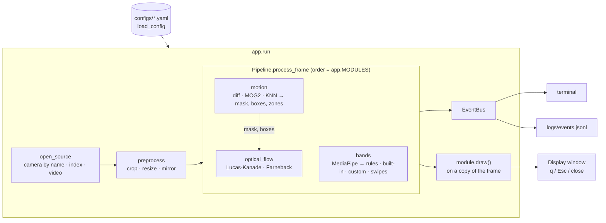
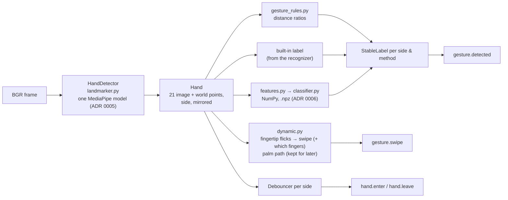

# Architecture (as built, v1)

How MoveCore is put together at the end of M6. The diagram in the project README shows the plan; this page shows the code.

## Frame loop

Each frame:

1. A `FrameSource` yields `(frame, timestamp_ms)`. Timestamps always increase (MediaPipe requires it).
2. `preprocess` crops to the target aspect ratio, resizes to 640×480 and mirrors when `input.flip` is on.
3. `Pipeline.process_frame` builds a `FrameContext` and calls each module's `process(ctx)` in registry order. A module can read the results of modules before it from `ctx.results` (optical flow reads motion's mask).
4. Every `Event` a module returns is published on the `EventBus`; the terminal printer and the JSONL logger are subscribers.
5. Unless headless, each module draws its own overlay (ADR 0004), then the FPS label is added and the frame is shown.

## Modules

| Name | Package | Reads | Produces | Events |
|---|---|---|---|---|
| `motion` | `motion/module.py` | frame | `mask`, `boxes`, `moving`, `active_zones` | `motion.start`, `motion.stop`, `zone.enter`, `zone.leave` |
| `optical_flow` | `motion/flow_module.py` | frame, motion's `mask`/`boxes` | `velocity`, `speed`, `direction`, `angle_deg`, per-box velocity | `flow.direction` |
| `hands` | `hands/module.py` | frame | `hands` (`HandReading` per hand), `paths` (palm), `trails` (per fingertip), `swipes` | `hand.enter`, `hand.leave`, `gesture.detected`, `gesture.swipe` |

Adding a module: subclass `core.module.Module` (`setup`, `process`, `close`, optional `draw`), take the config section as the only constructor argument, validate it with `core.options.OptionChecks`, and add one line to `app.MODULES`. Nothing else in the core changes.

## Inside the hands module

Training happens outside the live loop: `scripts/record_gestures.py` → `data/gestures/*.csv` → `scripts/train_gesture_classifier.py` (`hands/training.py`, the only code that imports scikit-learn) → `models/gesture_clf.npz`.

## Cross-cutting pieces

| Piece | Where | Why |
|---|---|---|
| Config validation | `core/config.py`, `core/options.py`, each module's settings | Bad values fail at startup with the option's full name; unknown keys are typos |
| Debouncing | `core/debounce.py` | Flicker becomes clean start/stop and label-change events |
| Event log | `output/event_logger.py` | One JSON object per line, flushed per event |
| Benchmark | `benchmark.py`, `scripts/benchmark.py` | FPS and peak memory per config, one process each |

## Not built in v1

- **Video recorder** (`output.record` in the configs): planned in the original diagram, not part of any milestone. The option is accepted and ignored.
- Body pose (v2) and face/expression (v3).
