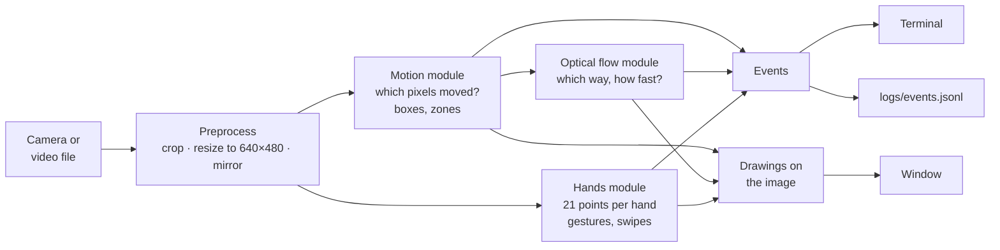
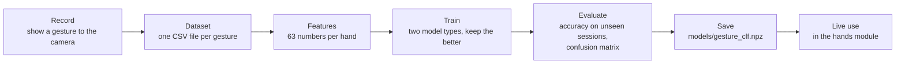

# How MoveCore Works — a guide from zero

This guide explains the whole MoveCore project for a reader who has never worked with computer vision, machine learning or this codebase. It covers what the program does, how it does it, how it was built and tested, and what it can't do yet.

Every technical word is explained the first time it appears, and the [glossary](#14-glossary) at the end collects them. The detailed notes for each topic are in [fundamentals/](fundamentals/); this page is the map that ties them together.

---

## Contents

1. [What MoveCore is](#1-what-movecore-is)
2. [Five ideas you need first](#2-five-ideas-you-need-first)
3. [The journey of one frame](#3-the-journey-of-one-frame)
4. [Part A: seeing motion without AI](#4-part-a-seeing-motion-without-ai)
5. [Part B: understanding hands with AI](#5-part-b-understanding-hands-with-ai)
6. [What comes out: the window and the event log](#6-what-comes-out-the-window-and-the-event-log)
7. [Configuration: changing behavior without changing code](#7-configuration-changing-behavior-without-changing-code)
8. [How the code is organized](#8-how-the-code-is-organized)
9. [Tech stack and why each tool was chosen](#9-tech-stack-and-why-each-tool-was-chosen)
10. [How it was built: method and milestones](#10-how-it-was-built-method-and-milestones)
11. [How fast it is](#11-how-fast-it-is)
12. [Limits and what's next](#12-limits-and-whats-next)
13. [Trying it yourself](#13-trying-it-yourself)
14. [Glossary](#14-glossary)

---

## 1. What MoveCore is

MoveCore is a program that watches a webcam (or a video file) and tells you **what is moving and how**. It runs on a laptop (a MacBook Air M1 with 8 GB of memory), works without an internet connection, and is built only from free, open-source tools.

It does two kinds of work:

| | Part A — Classic motion | Part B — Hands and gestures |
|---|---|---|
| Question it answers | "Did something move? Where, which way, how fast?" | "Is there a hand? What is it doing?" |
| How | Math on pixels, no AI | Pretrained AI models, plus rules and a model we train ourselves |
| Example output | A box around a walking person; "motion entered the left zone" | "Right hand: thumbs up"; "Left hand swiped left with two fingers" |

Running it opens a window showing the camera image with drawings on top (boxes, hand skeletons, labels, the frame rate). At the same time, every important moment, such as "motion started", "hand appeared" or "gesture detected", is printed in the terminal and saved to a log file.

**Why it exists.** It's a learning project. The goal is to understand computer vision step by step, from the simplest possible method (compare two pictures) up to machine learning, by building each step and measuring it. So the explanations matter as much as the code.

---

## 2. Five ideas you need first

### 2.1 An image is a grid of numbers

A digital image is a grid of tiny squares called **pixels**. MoveCore works at 640 × 480, so each image has 307,200 pixels. Each pixel stores three numbers from 0 (none) to 255 (full): how much blue, green and red light it has. A computer never "sees" a face or a hand; it sees about 900,000 numbers.

> **Detail:** the camera library MoveCore uses (OpenCV) stores colors in the order **B**lue-**G**reen-**R**ed (BGR), while the hand model (MediaPipe) expects **R**ed-**G**reen-**B**lue (RGB). Forgetting to convert swaps red and blue, which is a classic bug.

A **grayscale** image keeps one number per pixel (brightness only). That is three times less data, and often enough to notice motion.

### 2.2 A video is many images in a row

Video is a sequence of images called **frames**, shown quickly one after another. **FPS** (frames per second) is how many frames are handled each second. MoveCore aims for **at least 20 FPS**: everything it does to one frame must finish within $1000 / 20 = 50$ milliseconds.

We can write the brightness of the pixel at column $x$, row $y$, at time $t$ as $I(x, y, t)$. Motion means these numbers change over time.

### 2.3 Classic computer vision vs machine learning

- **Classic computer vision:** a person writes the formula. Example: "if a pixel's brightness changed by more than 25, call it moving." It's fast and transparent, but it only knows about pixels. It can't tell a hand from a cat.
- **Machine learning (ML):** instead of writing the rule, you show a program thousands of labelled examples ("this is a hand, its fingertips are here") and it tunes millions of internal numbers until its answers match. The result is a **model**: a file of learned numbers. Using a model on new images is called **inference**. Models can recognize *what* things are, but they cost more time per frame.

MoveCore uses both: Part A is classic, Part B is machine learning.

### 2.4 Landmarks

A **landmark** is a named point on an object. MoveCore's hand model returns **21 landmarks per hand**: the wrist, plus four points along each finger (knuckle, two joints, tip). With those 21 points, "is this a thumbs up?" becomes a geometry question about where the points are, not a question about pixels.

### 2.5 Events

The program doesn't just draw on the screen. It also produces **events**: short records saying something happened, with a name, a time and details. Example: `gesture.detected` with `hand: Right, gesture: thumb_up`. Events are what another program (a game, a smart-home controller, an accessibility tool) could react to.

---

## 3. The journey of one frame

Each frame from the camera goes through the same steps, about 20–70 times per second depending on what's turned on:



1. **Capture.** Read the next frame from the camera or the video file, along with its time in milliseconds.
2. **Preprocess.** Crop it to the right shape, shrink it to 640 × 480 (less work for every step after this), and **mirror** it left-to-right so the screen acts like a mirror: you raise your right hand, the hand on the right side of the screen goes up.
3. **Modules.** Each enabled **module** (a self-contained part that does one job) looks at the frame. They run in a fixed order, so a module can use the results of one that ran before it. The optical flow module, for example, only looks where the motion module found movement.
4. **Events.** Whatever the modules noticed is sent to everyone who listens: the terminal printer and the log file writer.
5. **Display.** Each module draws its own results onto a copy of the frame, the FPS counter is added, and the window shows it. Pressing `q` or `Esc`, or closing the window, stops the program.

That's the whole program. Everything else is the detail inside each module.

---

## 4. Part A: seeing motion without AI

### 4.1 Step 1: compare with the previous frame (frame differencing)

The simplest idea: subtract this frame from the last one, pixel by pixel.

$$D(x, y, t) = \left| I(x, y, t) - I(x, y, t-1) \right|$$

If nothing moved, $D$ is close to 0 everywhere. Where something moved, $D$ is large. Every pixel with $D$ above a **threshold** (25 by default) is marked white, the rest black. That black-and-white picture is the **motion mask**.

Two practical details:

- Cameras have **noise**: pixels flicker slightly even in a still room. So the frame is **blurred** first (each pixel replaced by an average of its neighbours), which smooths the flicker away.
- Differencing only sees the **edges** of motion. A moving box shows up as two strips, where it arrived and where it left, because its middle looks the same in both frames. A person who stops moving disappears at once.

### 4.2 Step 2: compare with a learned background (background subtraction)

A better idea: instead of the last frame, compare with a **model of the empty scene** that the program learns over time. MoveCore's default, **MOG2** (Mixture of Gaussians), remembers for each pixel the few colors it usually has, and how much each one varies. A ceiling fan or a flickering screen gets several "usual" colors. A pixel whose color doesn't fit any of them is **foreground** (something new in the scene).

The model keeps learning (it remembers about the last 500 frames), which has a consequence: **something that stops and stays slowly becomes part of the background.** A bag put down on a table fades from the mask within seconds, because after a while it *is* the background. When it's removed, its spot stays partly "blind" for a while until the model relearns the table behind it.

**Shadows.** MOG2 can recognize shadows: a pixel that kept the background's color but got darker. MoveCore ignores shadows so a person's box doesn't stretch along the floor. Early on, it fed MOG2 grayscale images and found a bias: dark objects (an orange sleeve against a light wall) were thrown away as "shadows", because in gray, "darker" is all a shadow test can check. In color, a shadow must also keep the same color, so the sleeve is kept. MoveCore now gives MOG2 the color image.

A second method, **KNN** (k-nearest neighbours), keeps actual past colors per pixel instead of averages. It can be selected instead of MOG2.

### 4.3 Step 3: clean the mask, find the boxes

The raw mask has specks (noise that got through) and holes (parts of an object that happened to match the background). **Morphology** fixes this by sliding a small square over the mask:

- **Erosion** shrinks white shapes, so single specks vanish.
- **Dilation** grows white shapes, so holes fill in.
- Erode then dilate (**opening**) removes specks; dilate then erode (**closing**) fills holes. MoveCore does both, then grows the shapes a little more so an arm and a body become one shape.

Then OpenCV traces the outline of each white shape (a **contour**). Shapes smaller than 500 pixels (about 22 × 22) are ignored as noise. Each remaining shape gets a **bounding box**, the rectangle drawn on screen.

### 4.4 Step 4: zones and stable events

A **zone** is a named area of the screen, given as fractions so it doesn't depend on resolution: `left_half: [0.0, 0.0, 0.5, 1.0]` means "from the left edge, top, half the width, full height". When enough moving pixels are inside it, the zone is active.

Raw "is there motion?" answers flicker from frame to frame. Turning every flicker into an event would flood the log, so MoveCore **debounces**: motion must last 2 frames before `motion.start`, and stillness must last 15 frames (half a second) before `motion.stop`. Starting fast and stopping slowly means someone pausing mid-step doesn't split one movement into two. The first 30 frames give no events at all, while the background model learns the scene.

Events from this module: `motion.start`, `motion.stop`, `zone.enter`, `zone.leave`.

### 4.5 Step 5: which way and how fast (optical flow)

The mask says *where* something changed, not *where it went*. **Optical flow** follows points from one frame to the next.

It rests on one assumption, **brightness constancy**: a point on a moving object keeps its color as it moves. That gives one equation per pixel with two unknowns (the horizontal and vertical speed), which isn't enough on its own. MoveCore offers two ways to add the missing information:

- **Lucas-Kanade (sparse, the default):** pick about 200 **corners** (points where the image changes in two directions, like the corner of a book; a plain wall has none) inside the moving area, and assume all pixels in a small window around each corner move together. Many pixels moving together give many equations for the same two unknowns, enough to solve. Each point is also tracked backwards to check it returns to where it started, and bad points are dropped.
- **Farneback (dense):** compute a motion for every pixel. It's slower, so it runs on a half-size image, and it can be shown as colors: the hue gives the direction and the brightness the speed.

The overall motion is the **median** (middle value) of the moving points, so a few badly tracked points can't pull it off course. It's given in pixels per second, plus a direction name (left/right/up/down) and an angle. A `flow.direction` event fires when the direction holds for 3 frames.

Optical flow is **off by default** in the current settings: it saves about 6 ms per frame and keeps the screen less busy. One line in the config turns it on.

### 4.6 What classic methods can't do

They react to *pixels changing*, so a light switching on, a camera shaking or a cloud passing looks like motion everywhere. A still object fades or vanishes. And they have no idea *what* moved. Part B fixes that last point for hands.

---

## 5. Part B: understanding hands with AI

### 5.1 Finding the 21 points (MediaPipe)

MoveCore uses Google's free **MediaPipe** models, downloaded once into `models/` and run locally. Finding a hand takes two neural networks, one after the other:

1. A **palm detector** scans the whole image for palms (a palm is a rigid, roughly square shape that's easier to find than a whole hand, whose fingers can bend any way).
2. A **landmark model** looks only inside the palm's box and returns the 21 points.

```
        8   12  16  20        ← fingertips
        |   |   |   |
        7   11  15  19
        |   |   |   |
   4    6   10  14  18
   |    |   |   |   |
   3    5---9---13--17        ← knuckles
    \   |           /
     2  |          /
      \ |         /
       1|        /
        0--------             ← wrist
```

Each point comes twice: as a position **on the image**, and as an estimated **3D position in metres** around the hand. The 3D version doesn't change when the hand moves closer to the camera, so it's the one used for gesture rules.

While a hand stays in view, the next frame's box is predicted from the current points, so the palm detector can be skipped (**tracking**). That's why a frame with no hand costs about 15 ms (it keeps searching), and a frame with hands about 27 ms (the landmark model runs once per hand).

**Left or right.** The model also says which hand it thinks it is. Its documentation says it assumes a mirrored image. Testing showed the opposite: on MoveCore's mirrored view, a right hand was called "Left". So MoveCore swaps the names back (`hands.mirrored: true`). The lesson the project kept: *documentation describes intent; a test with a known answer shows what the code really does.*

### 5.2 Four ways to name a gesture

With the 21 points, MoveCore recognizes gestures four ways. They run side by side, so you can compare them on the same hand.

**1. Rules (geometry, no training).** Hand-written checks on distances:

- *Is a finger straight?* A straight finger's tip is far from the wrist; a curled one folds back in. If the tip is more than 1.1 times as far from the wrist as the finger's middle joint, the finger is extended. (On test photos, straight fingers measured 1.19–1.61 and curled ones 0.60–0.99, so 1.1 falls between them.) Comparing *ratios* of distances means the rule doesn't care how big the hand looks or which way it points.
- *Finger count* = how many fingers are extended.
- *Pinch* = thumb tip and index tip closer than a quarter of the hand's size.
- *Thumb up/down* = only the thumb extended, pointing mostly up or down.

**2. The built-in recognizer (Google's model).** MediaPipe ships a third small network that names 7 gestures: closed fist, open palm, pointing up, thumb up, thumb down, victory, and "I love you". Each answer comes with a **confidence score** from 0 to 1; answers below 0.5 are ignored. This model already contains the landmark model, so MoveCore loads only this one file instead of two (it saves memory).

**3. A custom classifier (a model we train).** For gestures Google's model doesn't know, you teach your own. This is a full, small machine-learning workflow:



- **Record:** a script shows the camera; you hold a gesture and press SPACE. About 10 samples per second are saved (the 21 points, not the image).
- **Features:** the 21 points × 3 coordinates = 63 numbers, cleaned so that only the *shape* matters: positions are measured from the wrist (so where the hand is in the image doesn't matter), divided by the hand's size (so distance from the camera doesn't matter), and left-hand shapes are flipped to look like right hands (so one example teaches both hands).
- **Train:** two model types are tried. **Logistic regression** gives each gesture a weighted sum of the 63 numbers and picks the highest. A small **neural network** (one hidden layer of 64 units) can learn combinations like "index up *and* middle down". The more accurate one is kept; on a tie, the simpler one.
- **Evaluate honestly:** frames recorded a tenth of a second apart are near-copies. If near-copies are used both to train and to test, the test is like grading a student on questions they've already seen, so the score is meaningless (**data leakage**). MoveCore tests on *whole recording sessions* the model never saw (**cross-validation by session**), and prints a **confusion matrix**: a table of which gestures were mistaken for which.
- **Save safely:** Python's usual way to save models ("pickle") can run hidden code when loaded, so a downloaded model file could be malware. MoveCore saves only plain number arrays (`.npz`) and refuses anything else. The live program runs the model with a few lines of NumPy (about 0.04 ms per hand) and never loads the training library.

**4. Swipes (motion over time).** A thumbs up exists in one frame; a **swipe** only exists across frames. For each fingertip, MoveCore keeps its positions over the last 250 ms (a **sliding window**: old points drop off as new ones arrive). A fingertip's path counts as a swipe when:

1. that finger stayed extended the whole time (otherwise, opening a fist would look like an "up" swipe);
2. it moved at least 0.8 hand sizes within the 250 ms, so it was fast;
3. the path was fairly straight (a zigzag travels far but ends near its start);
4. one direction clearly dominates (diagonals are ignored rather than guessed);
5. it isn't the same swipe counted twice (there's a 400 ms pause after each swipe).

Distances are in **hand sizes**, not pixels, so a swipe means the same close to the camera or far away. If several fingers move together, it's one event that lists them, such as `fingers: [index, middle]`, not five events. On screen, each fingertip leaves a short colored trail.

The first version tracked the palm, not the fingertips. Tried live, it "felt like path tracking, not a swipe", because a swipe is a quick flick led by the fingers. So swipes moved to the fingertips. The palm's path is still tracked and drawn in gray, kept for future uses such as drawing in the air.

### 5.3 Hand events

| Event | Meaning | Details included |
|---|---|---|
| `hand.enter` | a hand appeared (seen 3 frames in a row) | which hand |
| `hand.leave` | it left (missing 10 frames in a row) | which hand, how long it was there |
| `gesture.detected` | a new gesture held for 5 frames | hand, gesture, method (`rules`, `builtin`, `custom`), score |
| `gesture.swipe` | a swipe | hand, direction, fingers, distance, speed, duration |

---

## 6. What comes out: the window and the event log

**The window** shows the mirrored camera image with each module's drawings: motion boxes and zones, flow arrows or colors, hand skeletons with their labels, fingertip trails, and the FPS. `--show-mask` adds the motion mask beside it, which is the best way to *see* what background subtraction is doing.

**The event log** is `logs/events.jsonl`. **JSONL** means one JSON record per line, appended as it happens. A crash never leaves a half-written file, and you can watch it live with `tail -f logs/events.jsonl`. An example line (formatted here for reading; in the file it's one line):

```json
{"logged_at": "2026-11-28T10:15:42.318+00:00", "type": "gesture.swipe", "source": "hands",
 "frame_index": 412, "timestamp_ms": 13733,
 "payload": {"hand": "Right", "direction": "left", "fingers": ["index", "middle"],
             "distance": 1.3, "speed": 7.9, "duration_ms": 165}}
```

`frame_index` and `timestamp_ms` say when in the video it happened. `payload` holds the details for that type of event.

---

## 7. Configuration: changing behavior without changing code

Everything adjustable lives in a YAML file (a simple text format for settings), `configs/default.yaml`. Every option there has a comment explaining it. A shortened view:

```yaml
input:   {width: 640, height: 480, camera: FaceTime HD, flip: true}
modules:
  motion:       {enabled: true,  method: mog2, threshold: 25, min_area: 500, zones: {}}
  optical_flow: {enabled: false, mode: sparse, min_speed: 40}
  hands:        {enabled: true,  max_hands: 2, swipe_window_ms: 250, swipe_min_distance: 0.8,
                 gestures: {rules: true, builtin_recognizer: true, custom_classifier: false, dynamic: true}}
output:  {overlay: true, show_fps: true, event_log: logs/events.jsonl}
```

Two smaller configs exist for running one part alone: `motion_only.yaml` and `hands_only.yaml`.

Settings are **checked at startup**. A wrong value or a misspelled option name stops the program with a message naming the exact option, instead of being silently ignored. A missing model file stops it before the camera opens, with the command to download it.

**The camera is chosen by name** ("FaceTime HD"), not by number. On a Mac, an iPhone nearby can appear as a camera and take number 0, so "camera 0" isn't reliably the laptop's own camera. MoveCore asks macOS for the camera list and finds the right number itself.

---

## 8. How the code is organized

```
configs/         settings files (YAML)
models/          downloaded and trained model files (not stored in git)
data/            recorded gestures and test videos (not stored in git)
scripts/         download_models · record_gestures · train_gesture_classifier · benchmark
src/movecore/
  core/          the frame contract, modules, events, config, debouncing
  capture/       camera and video file input
  preprocess/    crop, resize, mirror
  motion/        Part A: differencing, background subtraction, cleanup, zones, optical flow
  hands/         Part B: landmarks, rules, classifier, swipes, recorder, training
  output/        drawing, window, event log
  app.py, cli.py the main loop and the command-line options
tests/           unit tests (one file per building block) and integration tests (whole program)
docs/            these guides, design decisions, architecture, paper outline
```

**The plug-in rule.** Every module follows the same small contract: `setup()` before the first frame, `process(frame)` on each frame returning results and events, `draw()` for its overlay, `close()` at the end. A module receives its own section of the config and nothing else. Adding a new module (say, body pose in v2) means writing one new class and adding one line to the module list. The core loop doesn't change. This was a stated requirement from the start.

---

## 9. Tech stack and why each tool was chosen

| Tool | What it does here | Why this one |
|---|---|---|
| **Python 3.12** | the language | the standard for computer vision and ML; readable |
| **OpenCV** | camera, image operations, motion, optical flow | the reference library for classic CV, fast C++ underneath |
| **MediaPipe** (Tasks API) | hand landmarks and the built-in recognizer | free, runs well on a laptop, offline |
| **NumPy** | math on arrays of numbers; runs the custom model live | images *are* NumPy arrays |
| **scikit-learn** | training the custom classifier (only during training) | simple, well documented, light enough for 8 GB |
| **PyYAML** | reading the config files, in safe mode only | safe mode can't run code hidden in a file |
| **uv** | installs exact versions of everything from a lock file | fast, native on Apple Silicon, reproducible |
| **pytest** | automated tests | the standard Python test tool |
| **ruff** | style and bug-pattern checks, formatting | one fast tool for both |
| **pre-commit, gitleaks, pip-audit, Dependabot** | checks before each commit; secret scanning; known-vulnerability scanning; update alerts | a DevSecOps habit: catch problems before they're shared |
| **GitHub Actions** | runs all the checks on every push | the same checks on a clean machine, not just "works on my laptop" |

All of these are free and open source with permissive licenses (Apache, MIT, BSD).

**Deliberately left out:**

- **MediaPipe's old `mp.solutions` API.** Most online tutorials use it, but it was removed from MediaPipe and had problems on Apple Silicon. MoveCore uses the newer Tasks API, and tutorial code has to be translated rather than copied.
- **TensorFlow and MediaPipe Model Maker.** Too heavy and fragile for an 8 GB laptop; scikit-learn is enough for 63 numbers per hand.
- **Ultralytics YOLO** (object detection). Not needed for v1, and its AGPL license would force the whole project's code to be published under the same terms if it were distributed. A permissive alternative (RF-DETR) is noted for later.

Each significant choice is written down as a short **decision record** in [decisions/](decisions/) (context, decision, consequences), so the *why* survives after the conversation is forgotten.

---

## 10. How it was built: method and milestones

### 10.1 The working method

- **One milestone at a time.** Each one is finished, tested, checked and pushed before the next starts.
- **Explain, then build.** Every new technique gets a learning note in [fundamentals/](fundamentals/) with the idea, the math and what the settings mean.
- **Tests for everything.** Tests use **synthetic** images generated in code, such as a white square moving across a black frame, or a computed hand shape, so the right answer is known exactly. No webcam is needed, so the tests also run on GitHub's servers. Integration tests run the whole program on small generated videos and check the logged events. There are **354 tests** today.
- **A full check after every change:** lint, format, all tests, the pre-commit hooks and a secret scan, followed by a human review of the changes before anything is committed.
- **Live checks by a person.** Automated tests can't judge whether something *feels* right. Several real fixes came from trying it in front of the camera: the swapped left/right names, the dark-objects-as-shadows bias, and moving swipes from the palm to the fingertips.
- **Measure, don't guess.** Speed is measured whenever a module is added.

### 10.2 Milestones

| Milestone | What was built | One thing learned |
|---|---|---|
| **M0** | Project setup, automated checks and security scans | Tools must run natively on the M1 chip; an Intel-only install compiled for hours |
| **M1** | Camera and video input, resize, mirror, window, FPS counter | Cameras are numbered unreliably on a Mac; choose them by name |
| **M2** | Frame differencing, background subtraction, cleanup, boxes, zones, events | Gray images made dark objects look like shadows; color fixed it |
| **M3** | Optical flow: direction and speed | Corner tracking needs texture; a plain square has only four corners |
| **M4** | Hand landmarks, rule gestures, built-in recognizer | MediaPipe's left/right is the opposite of its docs on a mirrored image |
| **M5** | Gesture recorder, custom classifier, honest evaluation | An end-to-end test caught mirrored training data teaching the wrong shape |
| **M6** | Fingertip swipes, palm path, benchmark tool, architecture docs | A swipe is a fast fingertip flick, not a slow hand path |

Version 1 (M0–M6) is complete.

---

## 11. How fast it is

The benchmark script runs each configuration in its own process on the same video, skips the first 30 frames (start-up is slower than normal running), and reports frames per second and peak memory.

Measured on a clip of two hands at 640 × 480, while the laptop was also busy with other work:

| Configuration | FPS (target ≥ 20) | Peak memory (target < 1.5 GB) |
|---|---|---|
| Motion only | 70.7 | 163 MB |
| Hands only | 23.5 | 217 MB |
| Everything on | 19.0 | 275 MB |

Time per frame by part: preparing the frame 1.8 ms, motion 3.8 ms, optical flow 6.2 ms, **hands 37.7 ms** (with two hands the landmark model runs twice), swipes 0.2 ms. The hand models are by far the biggest cost. Memory is comfortably within the target.

"Everything on" was just under 20 FPS on a busy machine. The same clip ran at 25.4 FPS on a quieter machine during M4, and a fanless laptop also slows itself down when hot. A clean measurement on an idle machine is still to be done. If more speed is ever needed, the options are, in order of effect: track one hand instead of two, keep optical flow off (it already is by default), or turn off the built-in recognizer.

---

## 12. Limits and what's next

**Known limits:**

- Lighting changes and camera shake look like motion to Part A.
- A still object fades into the background within seconds (by design of background subtraction).
- A finger hidden behind the hand gets a *guessed* position, so a hidden thumb can occasionally read as a pinch.
- A fast whole-hand wave counts as a swipe, not only finger flicks. Whether that's wanted is an open question.
- The video recorder in the original plan isn't built; the option is accepted and ignored.

**Still to do for v1's write-up:** a benchmark on an idle machine with a real recording, a custom classifier trained on the developer's own gestures (at least 4 gestures plus "none", over 2+ sessions) with its confusion matrix, and a count of missed and false swipes per direction.

**Next versions:** v2 adds **body pose** (33 points on the body, for things like exercise counting or fall detection); v3 adds **face landmarks and expressions**. Thanks to the plug-in rule, each is a new module next to the existing ones.

---

## 13. Trying it yourself

On a Mac with Apple Silicon (the project is set up for macOS on arm64; Linux runs the tests in CI):

```bash
# once: install dependencies (exact versions from uv.lock) and download the hand models
uv sync
uv run python scripts/download_models.py

uv run movecore                                   # webcam, default config
uv run movecore --show-mask                       # also show the motion mask
uv run movecore --config configs/motion_only.yaml # only Part A
uv run movecore --source data/clips/clip.mp4 --loop
uv run pytest                                     # run all tests
```

The first camera run asks macOS for camera permission for the terminal app. A black window usually means it wasn't granted (System Settings → Privacy & Security → Camera). Quit with `q` or `Esc`.

---

## 14. Glossary

| Term | Meaning |
|---|---|
| **Background subtraction** | Finding moving things by comparing each frame with a learned picture of the empty scene |
| **BGR / RGB** | The order of the three color numbers per pixel; OpenCV uses BGR, MediaPipe RGB |
| **Bounding box** | The rectangle around a detected shape |
| **Confidence score** | A model's own estimate (0–1) of how sure it is |
| **Confusion matrix** | A table of true vs predicted labels; anything off the diagonal is a mistake |
| **Contour** | The outline of a white shape in a mask |
| **Corner** | A point where the image changes in two directions; trackable by optical flow |
| **Cross-validation** | Testing a model on data it didn't train on, rotating which part is held out |
| **Data leakage** | When test data secretly resembles training data, making scores look better than they are |
| **Debouncing** | Requiring a state to hold for a few frames before reporting a change |
| **Event** | A named record of something that happened, with time and details |
| **Features** | The numbers a model is given, here 63 cleaned-up landmark coordinates |
| **FPS** | Frames handled per second |
| **Frame** | One image in a video |
| **Frame differencing** | Finding change by subtracting the previous frame |
| **Inference** | Running a trained model on new input |
| **JSONL** | A text file with one JSON record per line |
| **Landmark** | A named point on an object, such as a fingertip |
| **Mask** | A black-and-white image marking which pixels are "moving" |
| **Model** | A file of numbers learned from examples, used to make predictions |
| **MOG2 / KNN** | Two background subtraction methods in OpenCV |
| **Module** | A self-contained part of MoveCore that does one job per frame |
| **Morphology** | Growing and shrinking white shapes in a mask to remove specks and fill holes |
| **Neural network** | A model made of layers of simple calculations, with weights tuned by training |
| **Optical flow** | Measuring how points move between frames: direction and speed |
| **Pixel** | One square of an image, three color numbers from 0 to 255 |
| **Sliding window** | Keeping only the most recent stretch of time, such as the last 250 ms |
| **Threshold** | A cut-off value: above it counts as yes, below as no |
| **Tracking** | Following an object from frame to frame instead of searching from scratch |

---

**Read more:** [fundamentals/](fundamentals/) for each topic in depth (01 images and video → 06 swipes and benchmarks) · [architecture/](architecture/README.md) for the code-level diagrams · [decisions/](decisions/) for why each major choice was made · [paper/outline.md](paper/outline.md) for the project paper.
